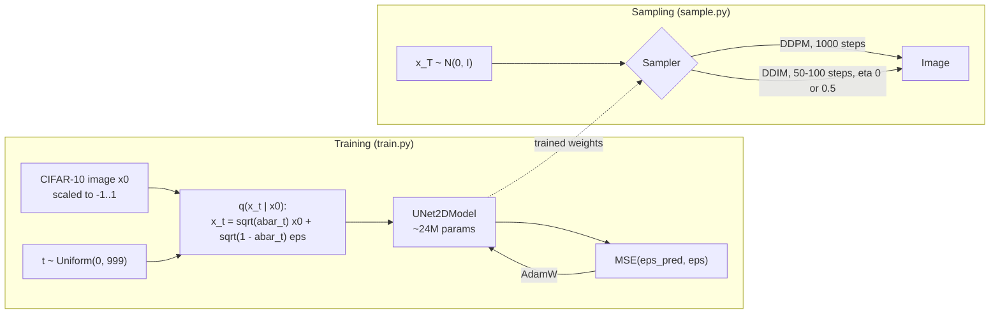
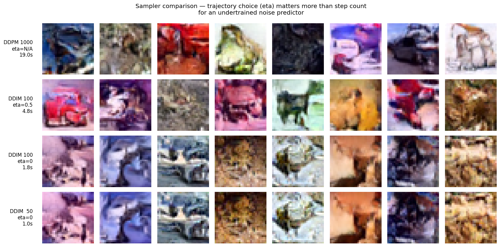
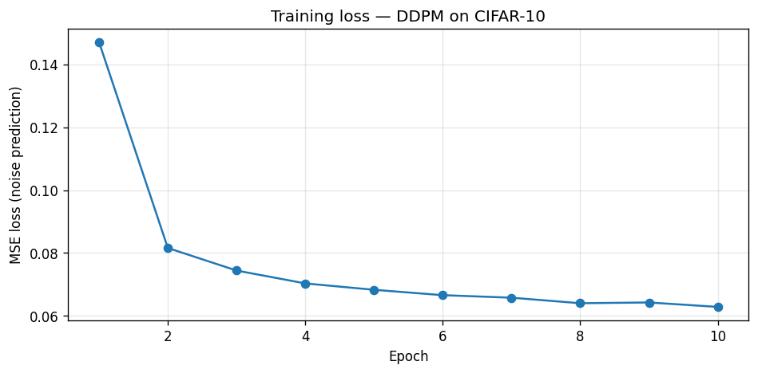
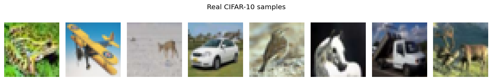
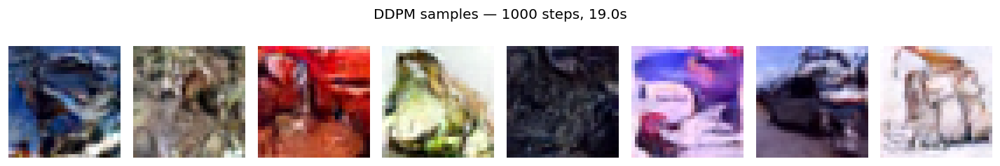
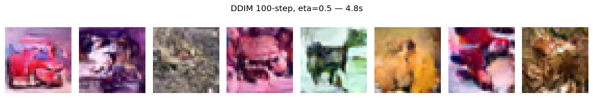

# Tiny Diffusion: DDPM and DDIM on CIFAR-10

A denoising diffusion model trained from scratch on CIFAR-10, plus a sampler study: DDPM vs DDIM at different step counts and noise levels (eta).

[](https://github.com/AdityaShekhawat0504/Tiny-diffusion/actions/workflows/ci.yml)

## Why it matters

Diffusion models give high-quality images but are slow to sample: plain DDPM calls the network 1000 times per image. DDIM can cut that 10-20x, but how much quality you lose depends on how well the model is trained. This repo measures that trade-off on a small, deliberately undertrained model (10 epochs) and finds that the sampler's trajectory (eta) matters more than its step count.

## How it works

A UNet learns to predict the noise added to an image at a random timestep t. Sampling runs that in reverse, from pure noise to an image, with either the DDPM or the DDIM update rule. Both samplers share the same trained network and the same cosine noise schedule.



More detail in [docs/ARCHITECTURE.md](docs/ARCHITECTURE.md).

## Results

All numbers below come from one run of [notebooks/exploration.ipynb](notebooks/exploration.ipynb) on a Colab Tesla T4 GPU (the notebook keeps its printed outputs). Quality is judged by visual inspection of 8 samples per sampler; there is no FID yet.



| Sampler | Steps (UNet calls) | Eta | Time for 8 samples | What the samples look like |
|---------|-------|-----|------------------|-------|
| DDPM | 1000 | n/a | 19.0 s | Sharpest; recognisable object structure |
| DDIM | 100 | 0.5 | 4.8 s | Close to DDPM quality with 10x fewer UNet calls |
| DDIM | 100 | 0.0 | 1.8 s | Visibly degraded: blurry, less object structure |
| DDIM | 50 | 0.0 | 1.0 s | Strongly degraded |

The notebook also timed DDIM 250 steps (eta 0) at 4.6 s; that grid is only in the notebook output.

**Finding.** Deterministic DDIM (eta = 0) amplifies the errors of an undertrained noise predictor: it takes large, committed steps with no correction. Stochastic DDIM (eta = 0.5) injects fresh Gaussian noise at each step, which acts like DDPM's full Markov chain and largely hides the predictor's mistakes. The eta = 0 rows at 100 and 50 steps look almost the same, so for this model more steps do not fix what eta fixes. With more training the eta = 0 gap should shrink.

Timing note: both 100-step DDIM runs make the same 100 UNet calls. Each timing is a single wall-clock measurement, so the 4.8 s vs 1.8 s gap between them is most likely run-to-run noise, not a cost of eta.

### Training



10 epochs, batch size 128, AdamW at lr 1e-4, seed 42: 390 batches per epoch, about 3,900 gradient steps in 25.0 minutes on the T4. The mean epoch loss fell from 0.1470 (epoch 1) to 0.0629 (epoch 10), with one flat spot (0.0640 at epoch 8, 0.0643 at epoch 9) and no spikes. Published CIFAR-10 DDPMs train for about 800k steps, so this model is heavily undertrained on purpose.

### Samples

Real CIFAR-10 images, for reference:



DDPM, 1000 steps:



DDIM, 100 steps, eta = 0.5:



The DDPM samples look like natural images: vehicle and animal silhouettes are visible in most of them and the colour statistics are plausible. What is missing is detail: edges are soft, textures are absent, and the object class is rarely nameable. That fits a model that has learned the coarse structure of the data but not the high frequencies.

## Quickstart

Python 3.10 to 3.12.

```bash
git clone https://github.com/AdityaShekhawat0504/Tiny-diffusion.git
cd Tiny-diffusion
python -m venv .venv && source .venv/bin/activate

# CPU-only machine: get the small CPU build of torch first (skip this on a GPU machine)
pip install torch==2.6.0 torchvision==0.21.0 --index-url https://download.pytorch.org/whl/cpu
pip install -r requirements-dev.txt

pytest                                         # CPU tests, no dataset download
python train.py --epochs 1 --max-batches 20    # smoke test: downloads CIFAR-10 (~170 MB), trains briefly
python sample.py                               # DDPM vs DDIM grid from that checkpoint
```

The smoke-test checkpoint only shows that the pipeline runs; its samples are noise. For the real run:

```bash
python train.py                # defaults = the notebook run: 10 epochs, batch 128, lr 1e-4
python sample.py
```

`--device` defaults to `auto` (CUDA, then Apple MPS, then CPU). Outputs go to `checkpoints/` and `outputs/`, so the committed results in `samples/` are never overwritten. Images from `sample.py` will not be pixel-identical to the committed ones: those come from the notebook, where the random state differed. Run `python train.py --help` or `python sample.py --help` for all options.

## Tech stack

Python, PyTorch, Hugging Face Diffusers (`UNet2DModel`, `DDPMScheduler`, `DDIMScheduler`), torchvision, matplotlib, NumPy, pytest, ruff, GitHub Actions.

## Project structure

```
diffusion.py              # shared code: model config, noise schedule, loss, sampling loop
train.py                  # CLI: train on CIFAR-10, save checkpoint and loss curve
sample.py                 # CLI: DDPM vs DDIM comparison grid from a checkpoint
notebooks/
  exploration.ipynb       # the original experiment, with outputs (source of all results)
samples/                  # result images from the notebook run
tests/                    # CPU tests: schedule, forward process, model, samplers
docs/ARCHITECTURE.md      # components, data flow, design decisions
.github/workflows/ci.yml  # ruff + pytest on every push and pull request
```

## Limitations and next steps

- **Undertrained.** 10 epochs (~3.9k steps) vs ~800k for published CIFAR-10 DDPMs. Next: train 100+ epochs and check whether the eta = 0 gap closes as the noise predictor improves.
- **No quantitative quality metric.** Claims rest on looking at 8 samples per sampler. Next: FID with `clean-fid` against the CIFAR-10 test set.
- **Single run, single seed.** Timings and comparisons are from one notebook run on one GPU. In that run the DDPM row did not start from the same noise as the DDIM rows.
- **No trained weights in the repo.** You have to train to sample.
- **Unconditional only.** Next: class-conditional generation with classifier-free guidance, and v-prediction instead of epsilon-prediction for better quality at low step counts.

## References

- Ho et al. (2020), [Denoising Diffusion Probabilistic Models](https://arxiv.org/abs/2006.11239)
- Song et al. (2020), [Denoising Diffusion Implicit Models](https://arxiv.org/abs/2010.02502)
- Nichol and Dhariwal (2021), [Improved Denoising Diffusion Probabilistic Models](https://arxiv.org/abs/2102.09672) (cosine noise schedule)
- [Hugging Face Diffusers documentation](https://huggingface.co/docs/diffusers)
