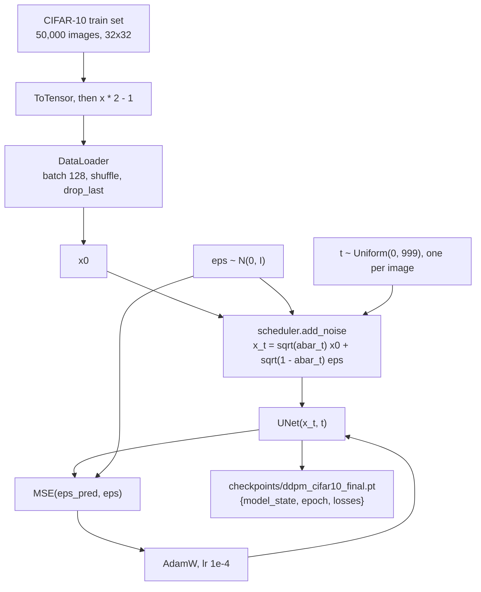
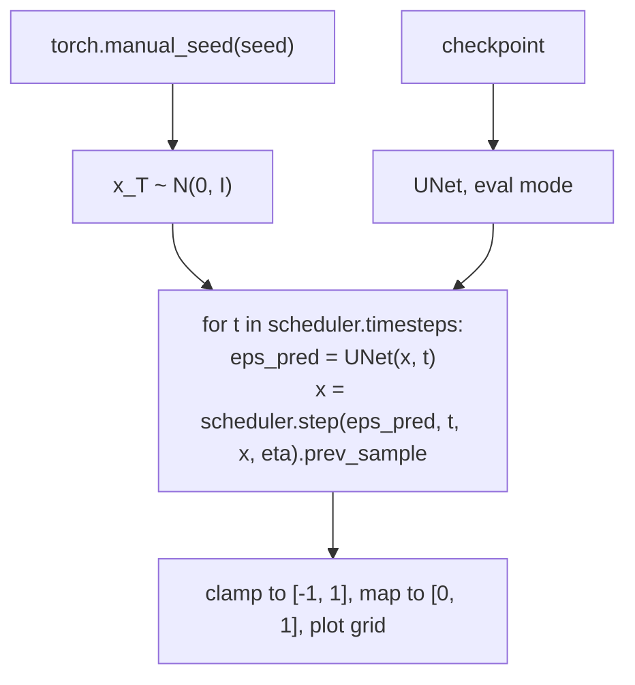

# Architecture

Tiny Diffusion is a small, script-based project: one shared module, two command-line entry points, one notebook that holds the original experiment, and a CPU test suite.

## Components

| File | Role |
|------|------|
| `diffusion.py` | Single source of truth for the model config, the noise schedule, the training loss and the sampling loop. Imported by everything else. |
| `train.py` | CLI. Loads CIFAR-10, trains the UNet with the epsilon-prediction loss, writes a checkpoint and a loss curve. |
| `sample.py` | CLI. Loads a checkpoint and samples 8 images each with DDPM (1000 steps) and DDIM (100 steps eta 0 and 0.5, 50 steps eta 0), then saves a comparison grid with timings. |
| `notebooks/exploration.ipynb` | The Colab run that produced every result and image in `samples/`. Kept unchanged as the experiment record. |
| `tests/` | CPU-only pytest suite with tiny tensors and a tiny UNet. No dataset download. |
| `.github/workflows/ci.yml` | ruff (lint + format check) and pytest on ubuntu-latest with CPU-only torch. |

### `diffusion.py`

- `MODEL_CONFIG` and `build_model()`: a Diffusers `UNet2DModel` for 32x32 RGB, 4 resolution levels with channels (64, 128, 256, 256), 2 ResNet layers per block, plain `DownBlock2D` / `UpBlock2D` (no attention). About 24M parameters (the notebook prints 23.99M).
- `build_ddpm_scheduler()`: `DDPMScheduler` with 1000 training timesteps and the cosine schedule `squaredcos_cap_v2`.
- `build_ddim_scheduler()`: `DDIMScheduler.from_config(...)` on the DDPM config, so both samplers use exactly the same betas and alpha-bars.
- `diffusion_loss()`: one training step's loss (see below).
- `sample()`: the reverse loop shared by both samplers.
- `resolve_device()`: `auto` picks CUDA, then Apple MPS, then CPU.
- `to_model_range()`: maps `ToTensor()` output from [0, 1] to [-1, 1].

## Data flow

### Training

Per batch: draw noise `eps`, draw one timestep per image, build `x_t` in closed form with `q(x_t | x_0)`, predict `eps` with the UNet, and minimise the mean squared error. The mean loss per epoch is logged and plotted.

### Sampling

`scheduler.set_timesteps(n)` picks which of the 1000 training timesteps are visited. DDPM visits all 1000. DDIM visits a strided subset (50 or 100) and takes larger jumps between them. `eta` controls how much fresh noise DDIM adds per step: 0 is fully deterministic, 1 recovers DDPM-like stochasticity.

## Key design decisions

- **Diffusers for the building blocks.** The UNet, the schedules and the update rules come from Hugging Face Diffusers. The project's own code is the training loop, the sampling loop and the experiment. This keeps the comparison about samplers, not about implementation bugs.
- **Cosine noise schedule.** A linear schedule destroys most of the signal early on, which hurts at 32x32. The cosine schedule keeps more signal at low and middle t (the tests check this against the linear schedule at t = 100, 250, 500 and 750).
- **Epsilon prediction with MSE.** The standard objective from Ho et al. (2020), equivalent to denoising score matching up to a per-timestep weight.
- **One trained model, many samplers.** DDPM and DDIM share one network and one schedule, so any difference in samples comes from the sampler alone.
- **Fixed seed per sampler run.** `sample()` seeds the global RNG before drawing `x_T`, so runs are repeatable and DDIM rows start from the same noise.
- **Shared module instead of copy-paste.** The notebook, `train.py` and `sample.py` originally each defined the UNet config. It now lives in `diffusion.py` (the notebook is left as run), so training, sampling and tests cannot drift apart.
- **Results stay put.** Scripts write to `outputs/` and `checkpoints/` by default, never to `samples/`, so a quick test run cannot overwrite the committed results.
- **Small, CPU-only tests.** Tests check math and shapes (schedule properties, the closed-form forward process and its variance, model output shape, sampler output shape for a few steps) with a tiny UNet, so CI runs in minutes without a GPU or dataset.
